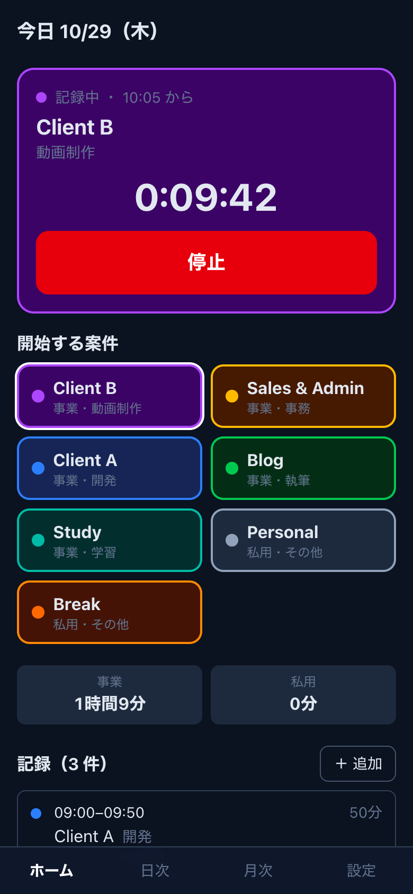
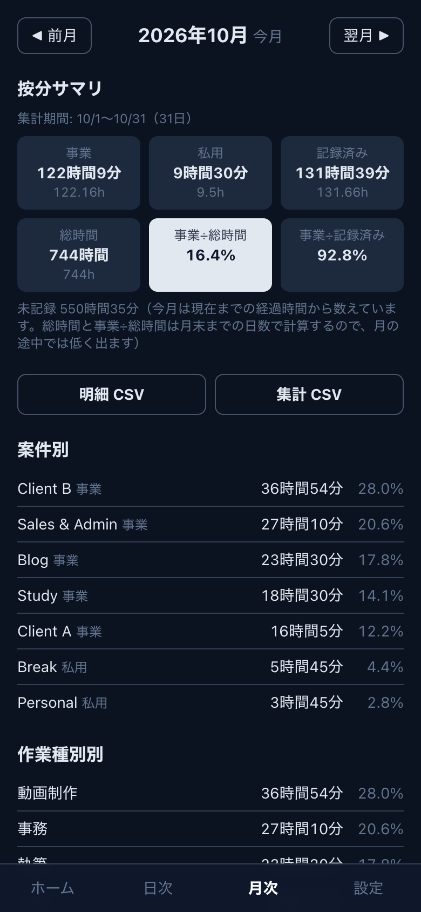
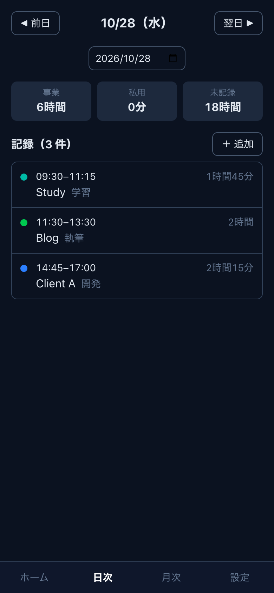

# worklog

TypeScript と React 19（Next.js 16）で作った、一人用の作業時間記録アプリ。事業／私用と案件・作業種別で時間を記録し、家事按分の根拠と案件別の工数を貯める。
LAN と Tailscale の内側（自宅 NAS の Docker）で動かす前提で、WAN には公開しない。

<p>
  
  
  
</p>

画面はすべてデモデータ（`seed/seed.demo.json` と `scripts/seed-demo-entries.ts`）で、実際の案件名や記録は含まない。

## English summary

A single-user time tracker built with TypeScript and React 19 (Next.js 16), self-hosted on a home NAS (Docker, LAN and Tailscale only). Japanese sole proprietors need time-based evidence to split home expenses between business and private use, so each entry is tagged business or private, with a project and an activity type.

- Start and stop a timer from the phone; edit or add entries by hand. Only one entry can run at a time, and the database enforces it with a partial unique index.
- An entry never crosses midnight JST: the app splits it at 0:00, and a CHECK constraint backs this up.
- Monthly report with two allocation ratios (business ÷ calendar hours, business ÷ recorded hours), per project, per activity and per day, plus CSV export.
- Daily `pg_dump` backup with a restore test that compares row counts and content hashes against the live database.
- Stack: TypeScript, React 19, Next.js 16 (App Router, Server Components and Server Actions), Drizzle ORM, PostgreSQL 18, Docker Compose. The "起動" section below runs it with demo data.

## 機能

- タイマーの開始・停止（稼働中は常に 1 件。別の案件で開始すると前の記録を自動で止める）
- 手入力と修正・削除（日付をまたぐ区間は JST の 0:00 で自動分割。時間の重なりは警告して、承知すれば保存）
- 日次一覧（事業・私用・未記録の合計）
- 案件・作業種別のマスタ（追加・編集・アーカイブ）
- 共通パスワード 1 つのログイン（署名付き Cookie、90 日）
- 月次レポート（事業・私用・未記録、事業÷総時間と事業÷記録済みの按分率、案件別・作業種別別・日別。記録 0 の日を強調）
- CSV 出力: 明細 `/api/month/YYYY-MM/entries.csv`・集計 `/api/month/YYYY-MM/summary.csv`（UTF-8 BOM・CRLF・JST）
- 日次バックアップ（`backup` コンテナが毎日 3:00 JST に `pg_dump -Fc`、30 日分を保持）と復元テストのスクリプト
- JSON API: `GET /api/timer`・`POST /api/timer/start`・`POST /api/timer/stop`・`GET /api/day/YYYY-MM-DD`

## 設計の要点

- 「稼働中は 1 件だけ」を部分ユニークインデックス `ON time_entries ((true)) WHERE ended_at IS NULL` で DB が保証する
- 「1 件の記録は JST の 1 日に収まる」を CHECK 制約で保証し、またぐ入力はアプリが 0:00 で分割してから保存する
- 時刻は `timestamptz`（UTC）で保存し、JST の日付は IMMUTABLE 関数 `jst_date()` を使った生成列 `entry_date` に持つ
- 月次の集計は秒で足してから分・時間に直す。明細 CSV の分を足すと集計 CSV に一致する。月をまたいで稼働中の記録は現在時刻までを 0:00 で切って両方の月に入れる
- `REPORT_START`（任意）より前の日は、月次レポートの分母にも分子にも入れない（記録を月の途中から始めた月のため）

## 構成

TypeScript ／ React 19 ／ Next.js 16（App Router）／ Drizzle ORM ／ PostgreSQL 18 ／ Docker Compose（`app`・`db`・`backup` の 3 コンテナ）。Node.js 24。

- 画面は Server Components で DB を読み、操作は Server Actions で書く。外から呼ぶ JSON API（`/api/timer` など）と CSV 出力だけ Route Handler にしている
- 操作の反応は Client Components で受ける（タイマーの経過表示、`useOptimistic` で開始・停止を先に画面へ反映、`useActionState` でログインのエラー表示、`useTransition` で送信中の表示）

## 起動

```bash
cp .env.example .env   # 値を入れる（AUTH_SECRET は openssl rand -hex 32）
docker compose up -d --build
docker compose exec app npm run db:migrate
docker compose exec app npm run db:seed   # seed/seed.demo.json（汎用名）を入れる
```

`http://localhost:3100` を開き、`.env` の `APP_PASSWORD` でログインする。

画面を試すだけなら、直近 28 日分のデモ記録も入れられる（記録が 1 件でもある DB では何もしない）。

```bash
docker compose exec app npm run db:seed-demo-entries
```

## 開発

```bash
docker compose -f docker-compose.yml -f docker-compose.dev.yml up -d db   # DB だけ 127.0.0.1:5433 に出す
npm ci
npm test            # Vitest（JST の日付分割・認証・月次集計と CSV）
npm run typecheck
npm run lint
```

マイグレーションは `npm run db:generate` で `drizzle/` に SQL を作り、中身を読んでからコミットする。本番では起動時に自動適用しない。

## NAS への配置

`.env.deploy`（コミットしない）に `DEPLOY_HOST`（ssh の接続名）・`DEPLOY_DIR`・`DEPLOY_URL` を書き、`./scripts/deploy-nas.sh` を実行する。
既定はソースを送って NAS 上でビルドする。`--image` を付けると Mac で `linux/amd64` のイメージを作って `docker save | docker load` で持ち込む。

## バックアップと復元

`backup` コンテナ（`postgres:18.6-alpine` と busybox の crond）が毎日 3:00（JST）に `backups/worklog_YYYYMMDD.dump` を書く。書いた直後に `pg_restore --list` で読めることを確かめ、`BACKUP_KEEP_DAYS`（既定 30）日より古いものを消す。ダンプは個人のデータを含むので 600 で置く。

```bash
docker compose exec backup /scripts/backup.sh         # 今すぐ取る
docker compose exec backup /scripts/restore-test.sh   # 最新のダンプを別 DB に戻し、表ごとに件数と中身のハッシュを本番と突合する
docker compose logs backup                            # 定期実行の結果
```

本番へ戻すときは app を止めてから `pg_restore --clean --if-exists --no-owner -d worklog <dump>` を流す（この手順はまだ本番で試していない。試したのは別 DB への復元と突合まで）。

## 作らないもの

- 複数ユーザー・権限・チーム集計（一人用に絞っている）
- 請求書・単価・売上の管理（工数と按分の根拠を貯めるところまで）
- インターネットへの公開（LAN と Tailscale の内側だけで使う）
